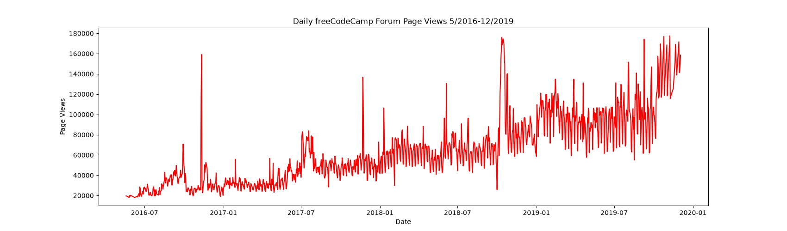
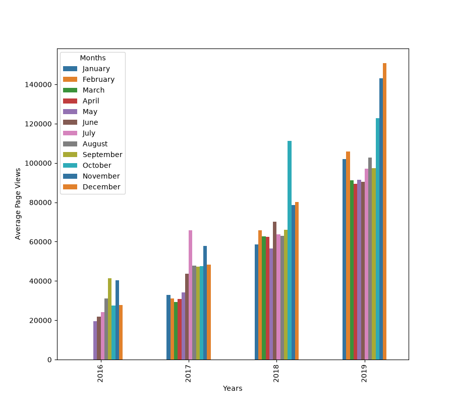
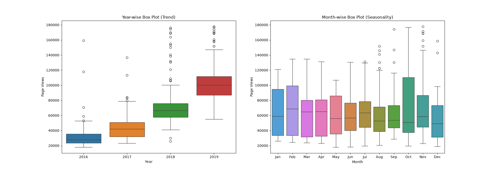

# Page View Time Series Visualizer

A program that analyzes daily page views on the freeCodeCamp.org forum from 2016 to 2019 to visualize trends and seasonality over time.

### Technologies

- Python
- Pandas
- Matplotlib
- Seaborn

### Visualizations

*Line chart showing daily freeCodeCamp.org forum page views from May 2016 to December 2019.*

*Bar chart showing average daily page views for each month grouped by year.*

*Box plots showing yearly trends and monthly seasonality in forum page views.*

---
This project was completed as part of the Data Analysis with Python certification from freeCodeCamp — [Page View Time Series Visualizer Project](https://www.freecodecamp.org/learn/data-analysis-with-python/data-analysis-with-python-projects/page-view-time-series-visualizer).
